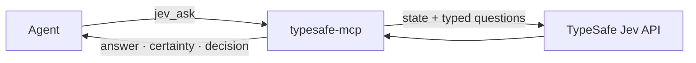

<div align="center">

# typesafe-mcp

**Deterministic decisions for AI agents — powered by TypeSafe AI's Jev.**

[](https://www.npmjs.com/package/typesafe-mcp)
[](https://github.com/MarkChu-git/typesafe-mcp/actions/workflows/ci.yml)
[](LICENSE)
[](https://bun.sh)

[npm](https://www.npmjs.com/package/typesafe-mcp) · [Documentation](#tools) · [Issues](https://github.com/MarkChu-git/typesafe-mcp/issues) · [Releases](https://github.com/MarkChu-git/typesafe-mcp/releases)

</div>

<br>

An MCP server that wraps **Jev**, TypeSafe AI's System One decision model, so **any agent** can ask typed questions and get compact, auditable answers back — the answer, how certain Jev is, and a threshold-gated `act / review / abstain` verdict. No generated text, no vibes, and as few tokens of the agent's context as possible.

```bash
bunx typesafe-mcp        # stdio server — add to any MCP host config, done
```



- **Jev** — TypeSafe AI's hosted decision model (`jev-latest` / `jev-1.14.0`). Evaluates a `state` plus typed questions (Noul / Choice / Score, and Box on images) and returns structured answers. It does **not** generate text, code, or explanations.
- **TypeSafe** — the company and API (`api.typesafe.ai/v1/systemone`) plus official JS/Python SDKs.
- **This server** — a type-safe MCP wrapper. `decision` is computed in code by this server, never Jev's own opinion about whether you may proceed.

## Install

Add to any MCP host config — Cursor, Claude Desktop, Claude Code, Windsurf, Cline, or a custom stdio client:

```json
{
  "mcpServers": {
    "jev": {
      "command": "bunx",
      "args": ["typesafe-mcp"],
      "env": {
        "TYPESAFE_API_KEY": "<paste-your-key-here>",
        "TYPESAFE_DEFAULT_MODEL": "jev-latest"
      }
    }
  }
}
```

Requires [Bun](https://bun.sh) on PATH. That's it — the host spawns a bundled single-file build over stdio. Without a key the server still connects and lists tools; calls return a `CONFIG:` error telling you where to put it.

| Env var | Default | Meaning |
| --- | --- | --- |
| `TYPESAFE_API_KEY` | — | Required for calls |
| `TYPESAFE_DEFAULT_MODEL` | `jev-latest` | Model used when a call does not pass `model` |
| `TYPESAFE_TIMEOUT_MS` | `10000` | Per-request timeout |
| `TYPESAFE_TOOLS` | `jev_ask` | Tools to expose: `all`, or a list such as `ask,models` |
| `TYPESAFE_FILES_ROOT` | the host's MCP roots, else the directory the host starts the server in | Directory `files` may read |
| `TYPESAFE_IMAGES` | off | `1` lets `files` send PNG and JPEG files to Jev as images, which TypeSafe still calls experimental |

**Upgrading from 0.1.x:** only `jev_ask` is on by default, and answers are now `{answer, certainty, decision}`. Set `TYPESAFE_TOOLS=all` to keep all five tools. The [v0.2.0 release notes](https://github.com/MarkChu-git/typesafe-mcp/releases/tag/v0.2.0) list every change.

<details>
<summary>Running from source</summary>

```bash
git clone https://github.com/MarkChu-git/typesafe-mcp.git && cd typesafe-mcp
bun install
bun run start        # stdio server — exits immediately if stdin closes
```

Point the host at the repo path instead — see [examples/stdio.mcp.json](examples/stdio.mcp.json) and replace `/ABSOLUTE/PATH/TO/typesafe-mcp` (`cursor.mcp.json` / `claude-desktop.json` are the same shape for their respective hosts).

</details>

## What it looks like

```jsonc
// jev_ask — state: "Help! My payouts have been failing for 3 days."
// questions: urgent (noul), dept (choice: billing / technical / sales), anger (score: Calm / Frustrated / Very angry)
{
  "answers": {
    "urgent": { "answer": true, "certainty": 0.9, "decision": "act" },        // p(yes) 0.95 → |0.95 − 0.5| × 2
    "dept": { "answer": "billing", "certainty": 0.81, "decision": "act" },
    "anger": { "answer": 1.05, "certainty": 0.92, "decision": "act" }         // expected level index
  }
}
```

That object is all the agent reads. Pass `"detailed": true` to add `probability` (noul) or `probabilities` (choice / score). The Jev model, token usage and the thresholds applied travel in the result's `_meta["typesafe.ai/jev"]`, which hosts keep out of the model's context.

To ask the same questions of many files, pass `files` instead of `state`. The server reads the files itself, so the agent neither copies their contents nor repeats the questions per item:

```jsonc
// jev_ask — files: "tickets/*.md", context: "Urgent means a customer's money is stuck."
{
  "files": {
    "tickets/T001.md": { "urgent": { "answer": true, "certainty": 0.9, "decision": "act" } },
    "tickets/T002.md": { "urgent": { "answer": false, "certainty": 0.84, "decision": "act" } }
  },
  "errors": { "tickets/big.md": "81 KB is over the 64 KB limit" }   // only when something was skipped
}
```

Logs, JSONL, CSV and Markdown files hold many records each. `items` splits every file into records and asks each one; `where`, `top` and `counts` keep only what the agent needs, so the result grows with the matches rather than the inputs:

```jsonc
// jev_ask — files: "logs/*.jsonl", items: "jsonl", where: { "incident": true }, counts: true
{
  "files": {
    "logs/app-03.jsonl:412": { "incident": { "answer": true, "certainty": 0.94, "decision": "act" } },
    "logs/app-07.jsonl:88": { "incident": { "answer": true, "certainty": 0.71, "decision": "review" } }
  },
  "total": 486,
  "matched": 2,
  "counts": { "incident": { "false": 484, "true": 2 } },
  "unsure": { "logs/app-07.jsonl:88": "{\"level\":\"warn\",\"msg\":\"replica lag 41s, failing over\"}" }
}
```

## Tools

By default the server exposes one tool, `jev_ask`, which covers every question type. Set `TYPESAFE_TOOLS` to choose the tools instead: `all`, or a list such as `ask,check` (the list replaces the default).

| Tool | Exposed | Input | `answer` |
| --- | --- | --- | --- |
| `jev_ask` | default | `state` or `files` (+ optional `context`, `items`, `where`, `top`, `counts`), `questions` (your ids → `{type, question, options \| levels \| criteria}`) | per question — **one** upstream call per state, file or record |
| `jev_check` | `TYPESAFE_TOOLS` | `state`, `question`, optional `criteria` | `true` / `false` |
| `jev_classify` | `TYPESAFE_TOOLS` | `state`, `question`, `options` (2–255) | the chosen label |
| `jev_score` | `TYPESAFE_TOOLS` | `state`, `question`, `levels` (2–10) | expected level index (may fall between levels) |
| `jev_models` | `TYPESAFE_TOOLS` | — | `models[]`, `default_model` — health check, no inference tokens |

Every question tool also takes `detailed`, `model`, `act_above` and `review_above`.

**What `files` may read.** Only files under `TYPESAFE_FILES_ROOT` when set, else under the MCP roots the host declares, else under the directory the host started the server in. Roots are deprecated as of protocol 2026-07-28 and this server only gets them in older sessions, so with Claude Code, which negotiates 2026-07-28 and starts the server in the project, `files` reads the project. That last fallback never uses `/`, the home directory or a directory above it: there `files` returns a `CONFIG` error until `TYPESAFE_FILES_ROOT` is set. Patterns must be relative and cannot contain `..`. Hidden files and directories (`.env`, `.git/…`) and private keys (`*.pem`, `*.key`, `id_rsa`, …) are never read, even through a symlink; wildcards skip symlinks; a path that resolves outside the root is skipped; `node_modules` is skipped unless the pattern names it. At most 100 files per call, each up to 64 KB, or 1 MB when `items` splits it, or 16 MiB for an image; anything skipped is listed in `errors` with the reason. Each file or record is sent to TypeSafe as one Jev request. The server reads with its own permissions, so a host rule that keeps the agent from reading a file does not stop `files`: keep secrets in hidden files or outside the root, or point `TYPESAFE_FILES_ROOT` at a narrower directory.

**Images.** With `TYPESAFE_IMAGES=1`, `files` also reads PNG and JPEG files, told apart by their first bytes, and sends each one to Jev as an image in `content`, judged whole whatever `items` says. Questions name it like any other field: "Does the page in `content` show an error message?" Jev takes still images of 280–1568 px a side. The server checks each image before sending it and lists any that does not fit in `errors`, with what to change, such as `2560×1440 px PNG; Jev takes at most 1568 px a side, so scale it down first`. The API ignores EXIF orientation, so rotate phone photos before asking. An image Jev is unsure about has no text to return in `unsure`, so `more_unsure` counts it. Images are billed as input tokens: one 1280×720 screenshot with a short question came to about 2,850. Each image request carries TypeSafe's `TypeSafe-Danger-Zone-Images: true` opt-in, since TypeSafe calls images experimental and may change their request format, answers and limits between releases. The switch adds one sentence about images to the instructions (155 characters), two to the `jev_ask` description (122 and 195) and `box` to the question types: the description and input schema grow by 354 characters, 231 of them for Box, and the output schema gains the box answer. Without it, PNG and JPEG files are skipped, `errors` names the switch, and the definition is the same as before Box.

**Box.** With `TYPESAFE_IMAGES=1`, a question can also be `` {"type": "box", "question": "the Checkout button in `content`"} ``, which asks where its target is in the image. Its `answer` is `{top, bottom, left, right}`: `top` and `bottom` are fractions of the image's height, `left` and `right` of its width, measured from the top-left corner. `certainty` is TypeSafe's confidence in the box, 0 when it reports none, so `decision` works as for the other types. Jev always returns a box, even for a target that is not in the image, so ask a noul in the same call whether it is there; the tool description tells agents so. A box question takes no `options`, `levels` or `criteria`, and it needs an image: asked with `state`, or without `TYPESAFE_IMAGES`, it fails before any request, and a text record in a `files` call is listed in `errors` instead of being sent. Every request with a box question carries the images opt-in. Box needs Jev 1.14 or later; `jev-latest` and `jev-preview` pointed to jev-1.14.0 on 2026-10-23. An older versioned model such as `jev-1.13.0` answers a box with a bare `400 Invalid request.`, so a call that would send one to it fails first and names `jev-1.14.0`, whether the call or `TYPESAFE_DEFAULT_MODEL` chose the model. In `where` a box question takes only `{decision}`, `top` cannot rank by one, and `counts` tallies its decisions. On 18 elements of the storefront screenshots, all 44 boxes with certainty 0.8 or more had their centre on the element, edges a median 4.7 px off. The 9 misses, all small text with no background of its own, came back as review, though one of them, asked in other words, reached 0.88 while still off target ([results](docs/evals/2026-10-23-box.md)).

**Records.** `items` splits every matched file into records, and each record gets the same questions in one Jev request:

| `items` | Record | Key in `files` |
| --- | --- | --- |
| `file` (default) | the whole file | `path` |
| `lines` | each non-blank line | `path:LINE` |
| `jsonl` | each non-blank line, parsed as JSON | `path:LINE` |
| `json` | each element of a top-level array | `path[INDEX]` |
| `csv` | each row after the header, as `{column: value}` | `path:LINE` |
| `sections` | each Markdown heading with its body, plus any text before the first heading | `path:LINE` |

Jev sees `{file, content, context}` for every record. Each record may be up to 64 KB. One call sends at most 500 records; a call that would send more fails before sending any.

**Filters.** They apply to every record of the call, in this order:

- `where` keeps the records whose answers match every condition. Per question id: a value or a list of values (noul: `true`/`false` or `"yes"`/`"no"`; choice: labels), `{min, max}` (score), `{decision}` (any type, and the only condition a box takes), or `{is, min, max, decision}` combined. `$or` takes a list of such objects and keeps a record when at least one of them matches, as in `{"$or": [{"r1": true}, {"r2": true}]}` for the files that break any of several rules; conditions next to it must still all hold. A label that is not one of the question's options fails the call before any request. A record that `where` leaves out returns none of its answers and no `unsure` text, so over a few dozen records or fewer, leave `where` out and take every answer.
- `top: {by, k}` ranks what `where` kept by a score's expected level or a noul's probability of yes, or by a weighted sum `{id: weight}`, and keeps the k highest (k ≤ 100).
- `counts: true` adds per-answer tallies over every answered record; a box question, whose answer is four edges, is tallied by its decisions. Without `where` or `top`, the result holds only the tallies.

With any of them the result also has `total`, the records answered, and with `where` it has `matched`, the records that passed. `errors` lists at most 20 entries, and `more_errors` counts the rest.

**Unsure records.** A returned record with a review or abstain answer also comes back with its text in `unsure` (record key → text) when the text is at most 2,000 bytes of UTF-8, up to 16,000 bytes per call; `more_unsure` counts the unsure records left out. Agents check those records anyway, and reading them in the result saves opening them in another step, which rereads the whole conversation. Bytes rather than characters keep the budget near the same number of tokens in any script. This is the only part of a `files` result that carries file text, so the warning above applies to it: a short file that a host rule keeps from the agent can still reach it here when Jev is unsure about it.

## Decision gating

| Field | Meaning |
| --- | --- |
| `certainty` | Noul: `\|probability − 0.5\| × 2` · Choice/Score/Box: API `confidence`, 0 for a box without one — rounded down to 2 decimals |
| `decision` | `certainty ≥ act_above` → `act` · `≥ review_above` → `review` · else `abstain`, taken on the rounded-down `certainty`, so the two never disagree and the gate is never looser than its thresholds |
| thresholds | Defaults `act_above 0.8`, `review_above 0.5` — overridable per call (`review_above ≤ act_above`); the values applied are in `_meta` for audit |

Pin `model` to a versioned id (e.g. `jev-1.14.0`) once thresholds are tuned — `jev-latest` can drift under a calibrated gate.

**中文提示**：`question`/`state` 支持中文，官方建议英文——Jev 按字面理解，中文问题准确率略低。`decision`/`certainty` 语义与语言无关。

## Token efficiency

Every tool definition sits in the agent's context on every model call, and every result stays there for the rest of the session, so both are kept small. Measured in Claude Code 2.1.284 (Sonnet) with `bun run eval --probes-only` and recorded API responses:

| | 0.1.1 | 0.2.0 |
| --- | --- | --- |
| Tool definitions in context | 4,842 tokens (5 tools) | 1,158 tokens (`jev_ask`; 3,030 with `TYPESAFE_TOOLS=all`) |
| `jev_ask` result, 3 mixed questions | 682 characters | 191 characters (−72%) |
| `jev_check` / `jev_classify` / `jev_score` result | 215 / 267 / 298 characters | 48 / 54 / 49 characters |

In one eval run where the agent was told to triage 30 ticket files with jev, asking per ticket took 37 calls, 31,189 characters of arguments and 14,690 output tokens; with `files` it took 2 calls, 1,846 characters and 1,912 output tokens.

The server also sends MCP instructions (997 characters) that say when to use `jev_ask`. Claude Code shows them even when it defers tool definitions, as it does in sessions with many MCP tools, where the agent otherwise sees only the tool's name. They ask agents to call `jev_ask` before reading or grepping more than about 50 files or records, and to read a handful of short files themselves. An earlier text asked for Jev even on a handful of files, and agents that were not told to use Jev then used it on 12 of 12 judgment-task runs with deferred tools and 10 of 12 with `jev_ask` loaded up front ([results](docs/evals/2026-10-12-willingness.md)). On small sets, though, reading cost fewer tokens: over six small judgment tasks, the current text cut the total by 24% with deferred tools and added 9% up front, with scores on two tasks 0.02–0.08 lower. Agents still asked Jev in every run of a 100-transcript task ([results](docs/evals/2026-10-15-read-small-sets.md)). `items`, `where`, `top` and `counts` grow the `jev_ask` definition from 3,165 to 4,070 characters, and the sentence on `unsure` brings it to 4,232. `$or` and the note on when to leave `where` out bring it to 4,396. `where` and `top` appear as plain objects whose descriptions name their shape, because typed unions would add about 150 tokens to every call. The token figures in the table predate these fields.

With `TYPESAFE_IMAGES=1`, agents triaging 40 storefront screenshots, whose answers were only in the images, used 37k–65k tokens per run when they asked Jev and 109k when they opened every screenshot themselves, 52% fewer on average, and scored 1.00 against 0.96. Jev took about 112k input tokens to look at the 40 screenshots once, billed by TypeSafe, so what the agent saves is context, Claude cost and time, not tokens overall. Most of what remains goes to opening the screenshots Jev was unsure about, since an image has no text to return in `unsure` ([results](docs/evals/2026-10-16-screenshots.md)).

Claude Code shows the model a tool's `structuredContent`, not its text block, and leaves `_meta` out — which is why usage and thresholds live there. [evals/](evals/README.md) compares whole agent runs with and without jev.

## Errors

Every failure returns `isError: true` with a category prefix:

| Category | Cause |
| --- | --- |
| `CONFIG` | `TYPESAFE_API_KEY` missing — where to set it is in the message · `files` has no project directory (no `TYPESAFE_FILES_ROOT`, no MCP roots, and the server was started in `/` or the home directory) |
| `VALIDATION` | Bad arguments — names the offending field · a `files` pattern that matches nothing, more than 100 files or more than 500 records · a `where` or `top` that does not fit the questions |
| `AUTH` | API rejected the key |
| `RATE_LIMIT` | Throttled — hint: batch questions through `jev_ask` |
| `OVERLOADED` / `UPSTREAM` | API-side 5xx after retries |
| `TIMEOUT` / `NETWORK` | Exceeded `TYPESAFE_TIMEOUT_MS` (default 10s) / unreachable API |
| `INVALID_REQUEST` | API rejected the payload (422) — includes field path |

Keys are redacted from error text; diagnostics go to stderr, never stdout.

## Development

Bun only — no Node/npm/pnpm/yarn/`npx`.

```bash
bun test                 # unit + in-process MCP tests (no key needed)
bun run test:integration # live API — skips entirely without TYPESAFE_API_KEY
bun run verify:fast      # tsc + type-aware oxlint + unit tests, in seconds
bun run verify           # the CI gate: verify:fast + knip + build + stdio smoke test of dist/
bun run scan             # gitleaks over the git history + osv-scanner over bun.lock
bun run inspect          # MCP Inspector over stdio
bun run eval --help      # agent token-efficiency evals (see evals/README.md)
bun run scripts/record-fixture.ts   # re-record tests/fixtures from the real API (needs key)
```

CI: `bun run verify` on Ubuntu, macOS and Windows; on Ubuntu also the Bend proofs in `evals/laws/` with a pinned Bend, the packed tarball smoke-tested as installed and gitleaks over the git history; plus Conventional Commits PR titles. All of these are required. CodeQL, osv-scanner, dependency review, actionlint and zizmor also run. A release builds one tarball, smoke-tests it, publishes that file via OIDC trusted publishing with `--provenance` (no long-lived npm token), and attaches an SPDX SBOM and GitHub attestations. See [CONTRIBUTING.md](CONTRIBUTING.md).

## Roadmap

Not implemented yet:

- Streamable HTTP transport (`createMcpHandler` + Hono/`Bun.serve`) for remote/shared deployments
- Object-shaped `instructions` on questions (structured prompts referencing `state` fields)
- Opinionated tools (`jev_gate` / `jev_screen` / `jev_match`) — pending the first business-scenario decision

## License

[MIT](LICENSE) · Research notes: [docs/research-jev-typesafe-mcp.md](docs/research-jev-typesafe-mcp.md) · Plan: [docs/plan-build-jev-mcp.md](docs/plan-build-jev-mcp.md)
